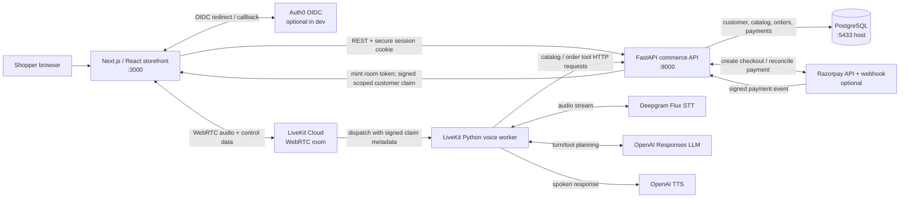

# HARIZON project guide: architecture, files, and request flows

This guide is a code-oriented map for the local project. Start with the architecture, then follow the relevant request flow and use the command section to inspect a running stack. Paths below are relative to the `ai-voice-commerce` project root.

## 1. What runs locally

| Component | Local address | Main responsibility |
|---|---|---|
| Next.js storefront | `http://localhost:3000` | Product discovery, cart, checkout screens, account/orders, typed assistant, and voice UI |
| FastAPI commerce API | `http://localhost:8000` | Sessions, customer authorization, catalog, orders, payment state, support tickets, assistant chat, and LiveKit tokens |
| PostgreSQL | host port `5433` | Customers, products, orders/items, payments/events, and support tickets |
| LiveKit | Configured LiveKit URL | Browser WebRTC room and audio/data transport |
| Python voice worker | Compose service `voice-agent` | Deepgram transcription, OpenAI conversation and speech, and commerce tools |

The catalog and policy text are synthetic development content. The local custom PostgreSQL commerce database is the order source for this project. Razorpay is optional; mock settlement is the default development flow. LiveKit, Deepgram, and OpenAI are external services when real-time voice is enabled.

## 2. Architecture



The voice browser never queries PostgreSQL. The worker never trusts a spoken order number as proof of ownership. For private order actions, the API mints a time-limited signed customer assertion only for a verified signed-in session, dispatches it to the worker, and checks it again on `/api/voice/orders`. The database query always filters by the customer ID in that assertion.

Raw audio, transcript text, and full conversation history are not deliberately persisted by this support flow. Voice logs report event type, room, durations, and outcomes; they avoid transcript content. `session.start(..., record=False)` explicitly disables session recording.

## 3. Full spoken turn: from microphone to answer

1. The shopper presses **Start live voice** in `frontend/components/live-voice.tsx`.
2. The browser sends `POST /api/voice/token` with `credentials: "include"`. The session cookie tells FastAPI whether the visitor has a verified customer account.
3. `backend/app/main.py::voice_token` creates a random room and visitor identity. It creates a signed `commerce_support` assertion only when the current customer exists and `email_verified` is true. The LiveKit token grants room join, publish, and subscribe; dispatch metadata contains the signed assertion (or `null`). The response includes the LiveKit URL and `customer_authenticated` flag.
4. The browser connects to the LiveKit room and publishes microphone audio. LiveKit dispatches the named worker `harizon-shop-assistant`.
5. `voice-agent/app.py::entry` connects to the room, reads the dispatch metadata, creates the `AgentSession`, and starts the agent with recording disabled. The session uses Deepgram Flux STT, OpenAI Responses for language/reasoning and tool calls, and OpenAI TTS for speech output.
6. `HarizonAgent` decides whether it needs a tool. `search_catalog` requests `/api/products`; `explain_policy` returns the current development policy text; `lookup_order_details` requests `/api/voice/orders` and attaches `X-Voice-Assertion`.
7. FastAPI checks assertion signature, age (maximum 30 minutes), scope, and current verified customer record. It parses the optional short order reference or date, and selects rows with `Order.customer_id == customer.id`. It serializes a limited order summary, never shipping address data.
8. The tool result returns to the LLM, which composes the response; TTS streams the spoken response through LiveKit to the browser.
9. The user can interrupt through voice activity detection. **Stop reply** sends a `stop_reply` control packet on the `harizon-control` topic, and the worker calls `session.interrupt(force=True)`. **End voice** disconnects the browser from the room.

### Order lookup rules

- Product, catalog, and general policy questions are public and do not require login.
- An order question is private. An unauthenticated or expired assertion produces an authentication response; the tool does not fetch order data.
- A six-digit order reference is preferred for voice. The ID remains internal. A placed date is accepted as an alternative, including formats such as `26-10/2026`; when several orders share the date, the API returns a clarification list.
- If the shopper supplies neither a reference nor date, the agent asks for one. The backend still checks ownership even when the reference is known.
- `voice_customer` is the boundary check; `find_customer_orders` applies the customer filter; `safe_summary` controls the fields exposed to the voice worker.

## 4. Typed chat is a different path

The storefront chat calls `POST /api/assistant/chat` directly from `frontend/components/storefront.tsx::sendMessage`. This is an HTTP request, not a LiveKit audio session. The API checks for product, policy, order-reference, and order-date intents and can return a deterministic answer from the local catalog/order data. Broader questions may use the configured OpenAI text API. The browser may optionally speak the returned text using its built-in `SpeechSynthesis` API, but that is not the real-time LiveKit TTS stream.

The storefront’s small microphone button uses browser `SpeechRecognition` when available, sends the recognized text to the same chat endpoint, then uses browser speech synthesis. Use the separate **Start live voice** control to exercise the LiveKit + Deepgram + OpenAI streaming path.

## 5. Other request flows

### Sign-in and user isolation

1. Storefront loads `/api/auth/config` and `/api/auth/me`.
2. With `AUTH_MODE=auth0`, `signIn` navigates to `/api/auth/login`. `auth.py::login` creates an OIDC state value and redirects to Auth0.
3. Auth0 returns to `/api/auth/callback`; the callback validates state and requires a verified email. The `sub` claim maps to one `Customer.auth_subject`. The API puts only the internal customer ID in the signed session cookie.
4. Every private REST endpoint uses `require_customer`. `/api/orders` filters by that customer ID; `/api/orders/{order_id}` includes both order ID and customer ID in the query. A different customer receives no order.
5. `AUTH_MODE=dev` exposes a single synthetic local shopper through `/api/auth/dev-login`; it is only available when `APP_ENV=development`.

### Checkout and payment reconciliation

1. The cart is held in browser state and local storage. Cart contents are not treated as authoritative prices or stock.
2. Checkout posts product IDs, quantities, and shipping address to `/api/checkout/orders`, with the customer session and an `Idempotency-Key`.
3. `CreateOrderRequest` validates shape and bounds. The API loads product prices and stock from the database, combines duplicate lines, validates availability, and computes totals server-side.
4. `get_payment_adapter()` selects mock or Razorpay. The API creates a provider order, reserves stock with conditional updates, stores order/items/payment in a database transaction, and returns the short numeric order reference.
5. In mock mode, the browser calls the development-only mock completion endpoint. With Razorpay, checkout happens in the provider UI; `/api/payments/verify` checks the HMAC signature server-side. The Razorpay webhook independently verifies the webhook signature.
6. `settle_payment` locks payment/order rows, ignores duplicate event IDs, and updates payment and order states together. A browser success page alone does not mark a payment paid.

### Human support

The storefront asks for confirmation before posting a ticket to `/api/support/tickets`. The API requires a signed-in customer and `confirmed: true`, stores the ticket under that customer, and returns a reference. The current voice agent directs the shopper to the website’s ticket flow rather than creating a ticket without a confirmation interaction.

## 6. File map

### Frontend

| File | Role |
|---|---|
| `frontend/app/page.tsx` | Next.js home route; renders the `Storefront` client component. |
| `frontend/app/layout.tsx` | Root HTML layout, metadata, global styles, LiveKit component styles. |
| `frontend/components/storefront.tsx` | Main storefront state and interactions: product query, category/sort, cart, compare, product detail, Auth0/dev login, order history, checkout, chat, browser speech, support ticket. |
| `frontend/components/live-voice.tsx` | LiveKit connection lifecycle, token fetch, microphone/session UI, stop-reply control packet, disconnect/error handling. |
| `frontend/app/globals.css` | Storefront-wide layout, typography, responsive styles. |
| `frontend/app/product-detail.css` | Product detail and zoom/modal presentation. |
| `frontend/app/live-voice.css` | Voice panel and live-state/control styles. |
| `frontend/package.json` | Next, React, LiveKit client/components, TypeScript, and build scripts. |
| `frontend/Dockerfile` | Container build and start for the Next.js app. |
| `frontend/next.config.mjs`, `frontend/tsconfig.json`, `frontend/tailwind.config.ts`, `frontend/postcss.config.mjs` | Framework, TS, and CSS build configuration. |

In `storefront.tsx`, the primary handlers are `load` (catalog), `signIn`/`signOut`, `loadCustomerOrders`, `sendMessage`, `submitCheckout`, and `createSupportTicket`. `addToCart`, `changeQuantity`, and `toggleCompare` update local UI state; the backend revalidates checkout data.

### Backend

| File | Role |
|---|---|
| `backend/app/main.py` | FastAPI app, session/CORS setup, serializers, date/reference normalization, customer-filtered voice lookup, catalog/order/payment/support/chat endpoints. |
| `backend/app/auth.py` | Auth0 OIDC routes, development sign-in, current-user endpoint, logout, and `require_customer` dependency. |
| `backend/app/config.py` | Environment-backed settings. Reads `.env` at runtime; inspect `.env.example` for variable names and never paste secret values into logs or docs. |
| `backend/app/database.py` | SQLAlchemy engine/session creation and request-scoped DB session dependency. |
| `backend/app/models.py` | SQLAlchemy tables and relationships for products, customers, orders/items, payments/events, support tickets. |
| `backend/app/schemas.py` | Pydantic validation for checkout items, shipping address, order creation, and chat input. |
| `backend/app/catalog.py` | Synthetic product seed data, catalog search/filter/sort. |
| `backend/app/payments.py` | Mock/Razorpay adapter and checkout/webhook signature verification helpers. |
| `backend/migrations/env.py`, `backend/alembic.ini` | Alembic migration configuration. |
| `backend/migrations/versions/0001_initial.py` | Initial tables. |
| `backend/migrations/versions/0002_customer_display_name.py` | Adds customer display name where needed. |
| `backend/migrations/versions/0003_order_reference.py` | Adds/backfills unique short numeric order references. |
| `backend/tests/test_store_flow.py` | API tests for storefront flow, auth, ownership, order/date lookup, idempotency, mock settlement, and support confirmation. |
| `backend/requirements.txt` | FastAPI/SQLAlchemy/Auth0 support/Postgres/Alembic/test dependencies. |
| `backend/Dockerfile` | API container and server startup. |

Important backend endpoints are `GET /api/health`, `GET /api/products`, `GET /api/products/{id}`, the `/api/auth/*` routes, `POST /api/voice/token`, `GET /api/voice/orders`, `POST /api/assistant/chat`, `POST /api/checkout/orders`, `GET /api/orders`, `GET /api/orders/{id}`, `/api/payments/*`, and `/api/support/tickets`.

### Voice and root configuration

| File | Role |
|---|---|
| `voice-agent/app.py` | LiveKit agent instructions, catalog/policy/order tools, provider wiring, interruption and stop handling, privacy-minded event logs. |
| `voice-agent/requirements.txt` | LiveKit Agents with Deepgram/OpenAI plugins and HTTP client. |
| `voice-agent/Dockerfile` | Voice worker image and LiveKit worker startup. |
| `compose.yaml` | Local PostgreSQL, API, storefront, optional `voice` profile worker, ports, environment wiring, health check, persistent DB volume. |
| `.env.example` | Safe variable-name template. `.env` contains local values/secrets and is ignored by Git. |
| `README.md` | Project entry point and links to local setup and this guide. |
| `docs/LOCAL_DEVELOPMENT.md` | Guided setup and manual test instructions. |

## 7. Where to watch the flow

From the project root:

```powershell
docker compose --profile voice ps
docker compose logs -f web
docker compose logs -f api voice-agent
docker compose logs -f db
```

Voice worker events include `session.connecting`, `session.connected`, `session.identity`, `session.ready`, `turn.transcribed` (final/interim flag only), `agent.state`, `tool.started`, `tool.completed`, `tool.failed`, `voice.interruption.detected`, `voice.stop_requested`, `voice.reply_stopped`, and `session.closed`. API logs include token issuance and authorized/denied order lookup metadata. No transcript text is intentionally logged.

For an authenticated order lookup, useful entries should show an authenticated token/session, then `tool.started name=lookup_order_details`, then a completed result (`found=true` or a clarification). A timeout or failed API request is reported as a short spoken recovery response. If the token reports `authenticated=false`, first inspect the browser's sign-in state and ensure the voice token request includes credentials. Do not dump environment variables or session/assertion tokens when diagnosing.

## 8. Build, start, and verify

Run from the project root in PowerShell.

```powershell
# Build and run database, API, web, and real-time voice worker
docker compose --profile voice up -d --build

# Check containers
docker compose --profile voice ps

# Check storefront and API health
Invoke-WebRequest http://localhost:3000 -UseBasicParsing
Invoke-WebRequest http://localhost:8000/api/health -UseBasicParsing
Invoke-WebRequest http://localhost:8000/api/auth/config -UseBasicParsing
```

After code changes, rebuild the relevant service:

```powershell
docker compose build web       # Next.js / React / CSS changes
docker compose up -d web

docker compose build api       # FastAPI / database model / dependency changes
docker compose up -d api

docker compose --profile voice build voice-agent  # voice worker changes
docker compose --profile voice up -d voice-agent
```

Changes to `NEXT_PUBLIC_*` values are embedded into the frontend build, so rebuild `web`. Changes to Python source need the corresponding container rebuilt. `.env` changes are read when containers are created; recreate affected services. If using a non-voice storefront-only run, use `docker compose up -d --build db api web`. For real-time voice, include `--profile voice` and supply valid LiveKit, Deepgram, and OpenAI credentials in the local environment file.

The app should respond at `http://localhost:3000`; API health should return JSON with `status: ok` at `http://localhost:8000/api/health`. The auth config endpoint returns mode/readiness metadata, not secrets.

Stop containers while retaining local database data:

```powershell
docker compose --profile voice down
```

`docker compose down -v` deletes the local PostgreSQL volume and local data; reserve it for when you intentionally want to reset the database.

## 9. Diagnostic and build commands

### Container and endpoint checks

```powershell
docker compose --profile voice ps
docker compose logs --tail 150 api
docker compose logs --tail 200 voice-agent
docker compose logs --tail 100 web
docker compose logs --tail 100 db

Invoke-WebRequest http://localhost:8000/api/health -UseBasicParsing
Invoke-WebRequest http://localhost:8000/api/products -UseBasicParsing
```

### Database checks

```powershell
docker compose exec db psql -U commerce -d commerce -c "SELECT count(*) AS products FROM products;"
docker compose exec db psql -U commerce -d commerce -c "SELECT status, payment_status, count(*) FROM orders GROUP BY status, payment_status;"
```

These queries show aggregate state without printing customer addresses or emails. For an order's display reference and state, use the signed-in account page. Avoid broad `SELECT *` output because order and customer tables contain personal data.

### Automated checks

Backend tests (use the project virtual environment if already created):

```powershell
cd backend
..\backend\.venv\Scripts\python.exe -m pytest tests\test_store_flow.py -q -p no:cacheprovider
```

Frontend type check, from a second terminal:

```powershell
cd frontend
node_modules\.bin\tsc.cmd --noEmit
```

Production frontend bundle build:

```powershell
cd ..
docker compose build web
```

To see available backend routes interactively, open `http://localhost:8000/docs` while the API is running. This is the FastAPI OpenAPI UI.

## 10. Test the user journeys manually

1. Open `http://localhost:3000`; confirm the catalog loads and search/filter/product detail work.
2. Sign in using the configured Auth0 flow or the local development shopper. The account control should change to the customer name.
3. Add a product to the cart and place an order. In mock mode the page completes mock payment; note the six-digit order reference.
4. Open the account/order list and check date, item, total, and status.
5. Ask typed chat for the order status by reference, and separately by a date. It should return only an order belonging to the signed-in customer.
6. Start Live Voice, ask a public product or policy question, then ask for order status by the short reference. Also try without signing in to verify the assistant asks for login and reveals no order details.
7. While the agent is speaking, use **Stop reply**; then use **End voice** to leave the room. Check the voice worker logs for stop/interruption and room-close events.
8. Request a human handoff from the website, confirm ticket creation, and check that a reference is returned.

## 11. What these checks prove—and do not prove

The current automated backend suite exercises three API-level store flows using a local test database. It covers account scoping, date/reference normalization, checkout idempotency, mock payment state, and support confirmation. It does not run a real browser, Auth0 tenant, LiveKit Cloud audio call, or Deepgram/OpenAI provider round trip. Manual real-time voice testing requires provider credentials and network connectivity.

The code is structured for a local end-to-end development loop. Production readiness still needs operational validation: real payment webhook setup, auth/session deployment settings, privacy/retention review, monitoring/alerts, backup/restore, and load tests for the desired concurrent sessions. Current product, stock, policy, and order records are synthetic/local development data; do not treat them as a live commerce system.
